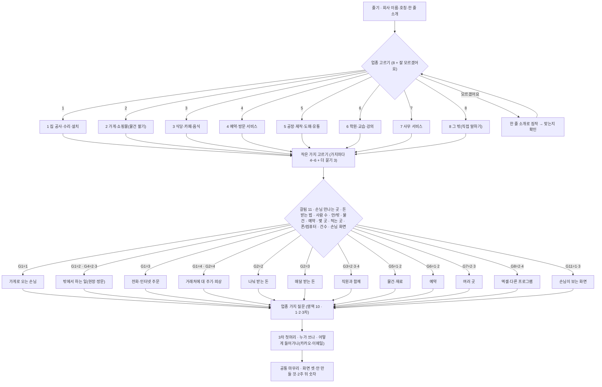

# 가지 방식 인터뷰 — 줄기 · 갈림 · 가지 속 가지 (라이브 ERP 클래스 · 다업종)

> **생성 파일 — 손으로 고치지 않는다.** 원본 `interview-tree.mjs` → `node tools/build-interview.mjs`. 업종 가지 8개는 `branches/` 폴더에 하나씩 있다.

## 0. 나무 모양

묻는 순서(1차): **줄기 → 업종 → 작은 가지 → 작은 가지 질문 → 갈림 11 → 업종 가지의 1차 질문 → 붙은 가지 속 가지의 1차 질문 → 공통 1차 마무리 → 요약**. 2차·3차는 **쉬지 않고 이어서** 같은 가지를 따라 그 차수 질문만 묻는다(아래 6절). 3차 첫머리에 **누가 쓰나·어떻게 들어가나**를 묻고, 그 답이 초안 세팅으로 이어진다.

## 1. 줄기 — 모든 업종 공통 (1차 첫머리)

| 번호 | 질문 | 보기 |
|---|---|---|
| J1 | "회사 이름이랑, 제가 어떻게 불러 드리면 될지 알려 주세요." | — |
| J2 | "아는 분께 회사 소개하실 때 한 줄로 뭐라고 하세요?" | — |
| J3 | "하시는 일이 아래 중 어디에 제일 가까우세요? 번호로 말씀하셔도 돼요." | 1 집 공사·수리·설치 · 2 가게·쇼핑몰(물건 팔기) · 3 식당·카페·음식 · 4 예약·방문 서비스(미용·운동·청소·수리·돌봄) · 5 공장·제작·도매·유통 · 6 학원·교습·강의 · 7 사무 서비스(세무·디자인·IT·중개) · 8 그 밖(직접 말하기) · 9 잘 모르겠어요 · 10 기타(직접 말하기) |

- J3 에서 「잘 모르겠어요」면 J2 한 줄 소개로 가장 가까운 가지를 짐작해 **"그럼 ○○ 쪽으로 보고 여쭐게요. 맞죠?"** 로 확인한다. 둘에 걸치면 손이 더 가는 쪽이 주 가지, 다른 쪽은 보조 가지(2차 「첫 일」 후보 하나만 가져온다).
- 「기타(직접 말하기)」는 8 그 밖 가지로 간다.

## 2. 업종 가지 8

| 번호 | 가지 | 작은 가지(번호 보기) | 질문 파일 | 더 깊이(번들 원본 업종 팩) |
|---|---|---|---|---|
| 1 | 집 공사·수리·설치 | 집 전체 공사 · 부분 공사·수리 · 가게·사무실 공사 · 전기·배관·냉난방 공사 · 창호·간판·가전 설치 | `branches/b1-construction.md` | `taxonomy/02-construction.md` |
| 2 | 가게·쇼핑몰(물건 팔기) | 동네 가게 · 인터넷 쇼핑몰 · 가게와 인터넷 둘 다 · 물건 빌려주기(렌탈) | `branches/b2-retail.md` | `taxonomy/03-retail.md` |
| 3 | 식당·카페·음식 | 식당·술집 · 카페·빵집 · 배달·포장 전문 · 단체 도시락·출장 음식 · 반찬·식품 만들어 팔기 | `branches/b3-food.md` | `taxonomy/04-food-lodging.md` |
| 4 | 예약·방문 서비스 | 미용실·네일·피부 · 운동·필라테스·요가 · 청소·방역·이사 · 출장 수리(가전·보일러·컴퓨터) · 돌봄(아이·어르신·반려동물) · 숙박·공간 빌려주기 | `branches/b4-service.md` | `taxonomy/05-home-services.md · taxonomy/08-health-beauty.md` |
| 5 | 공장·제작·도매·유통 | 주문 받아 만들기 · 같은 물건 계속 만들기 · 맡긴 물건 가공 · 도매·유통(들여와서 거래처에 대 주기) · 공방·수제품 | `branches/b5-making.md` | `taxonomy/01-manufacturing.md · taxonomy/03-retail.md(3.2 도매)` |
| 6 | 학원·교습·강의 | 교과 학원·공부방 · 예체능(음악·미술·운동) · 어학 · 자격증·직업 교육 · 원데이 클래스·출강 | `branches/b6-education.md` | `taxonomy/07-education.md` |
| 7 | 사무 서비스 | 세무·회계 · 노무·법률 사무 · 디자인·광고·영상 · IT 개발·관리 · 부동산 중개·관리 · 컨설팅·교육 대행 | `branches/b7-office.md` | `taxonomy/06-professional.md` |
| 8 | 그 밖(직접 말하기) | 농사·식품 생산 · 행사·공연 기획 · 운송·배송 · 병원·의원 운영 · 협회·단체·모임 · 위 어디에도 없음 | `branches/b8-other.md` | `taxonomy/10-other.md · taxonomy/09-logistics.md · taxonomy/08-health-beauty.md(의원 운영) — 가장 가까운 팩` |

작은 가지를 고르면 그 작은 가지의 「더 묻는 것」 3개를 먼저 묻는다. 작은 가지에 딱 맞는 원본 업종 팩 칸이 있으면 그 칸의 「이 업종의 말」로 질문 속 낱말을 바꿔 쓴다(질문을 더하지는 않는다).

## 3. 갈림 11 — 고른 번호가 가지 속 가지를 붙인다

| 번호 | 질문 | 보기 | 붙는 가지 속 가지 |
|---|---|---|---|
| G1 | "손님은 주로 어디서 만나세요?" | 1 손님이 가게·사무실로 와요 · 2 제가(직원이) 손님 쪽으로 가요 · 3 전화·인터넷으로 주문받아요 · 4 회사나 가게에 물건·일을 대 줘요 · 5 여러 가지가 섞여 있어요 · 6 잘 모르겠어요 · 7 기타(직접 말하기) | 1 → M1 / 2 → M2 / 3 → M3 / 4 → M4 / 5 → (섞임 — 손이 많이 가는 쪽 두 개) |
| G2 | "돈은 주로 어떻게 받으세요? 금액은 말 안 하셔도 돼요." | 1 그 자리에서 바로 · 2 나눠서(먼저 조금, 끝나고 나머지) · 3 매달 정해진 날 · 4 월말에 모아서(외상) · 5 섞여 있어요 · 6 잘 모르겠어요 · 7 기타(직접 말하기) | 2 → M5 / 3 → M6 / 4 → M4 / 5 → (섞임 — 손이 많이 가는 쪽) |
| G3 | "대표님 빼고 함께 일하는 분은 몇 분이세요?" | 1 없어요(혼자) · 2 1~4명 · 3 5~19명 · 4 20명 넘게 · 5 잘 모르겠어요 · 6 기타(직접 말하기) | 2 → M7 / 3 → M7 / 4 → M7 |
| G4 | "일은 주로 어디서 하세요?" | 1 사무실·가게 안에서 · 2 밖에서(현장·손님 집) · 3 안과 밖 둘 다 · 4 잘 모르겠어요 · 5 기타(직접 말하기) | 2 → M2 / 3 → M2 |
| G5 | "물건이나 재료를 쌓아 두고 쓰세요?" | 1 네, 종류가 많아요 · 2 조금 있어요 · 3 거의 없어요 · 4 잘 모르겠어요 · 5 기타(직접 말하기) | 1 → M8 / 2 → M8 |
| G6 | "예약을 받으세요?" | 1 네, 거의 다 예약이에요 · 2 가끔 받아요 · 3 아니요 · 4 잘 모르겠어요 · 5 기타(직접 말하기) | 1 → M9 / 2 → M9 |
| G7 | "가게나 사무실은 몇 곳이에요?" | 1 한 곳 · 2 두세 곳 · 3 네 곳 넘게 · 4 잘 모르겠어요 · 5 기타(직접 말하기) | 2 → M10 / 3 → M10 |
| G8 | "지금 일은 주로 어디에 적어 두세요?" | 1 종이·수첩 · 2 엑셀·구글 시트 · 3 카톡·문자 · 4 다른 프로그램 · 5 거의 안 적어요 · 6 잘 모르겠어요 · 7 기타(직접 말하기) | 2 → M11 / 4 → M11 |
| G9 | "앱은 주로 무엇으로 보시게 될까요?" | 1 휴대폰 · 2 컴퓨터 · 3 둘 다 · 4 태블릿 · 5 잘 모르겠어요 · 6 기타(직접 말하기) | — (화면 모양·글자 크기 판단에만 씀) |
| G10 | "한 달에 챙기는 일은 몇 건쯤이에요? 대충이면 돼요." | 1 열 건 안쪽 · 2 수십 건 · 3 수백 건 넘게 · 4 잘 모르겠어요 · 5 기타(직접 말하기) | — (화면 모양·글자 크기 판단에만 씀) |
| G11 | "손님이 앱 화면을 직접 볼 일이 있을까요?" | 1 네, 지금도 사진·진행 상황을 보내 드려요 · 2 아니요 · 3 있으면 좋겠어요 · 4 잘 모르겠어요 · 5 기타(직접 말하기) | 1 → M12 / 3 → M12 |

- 업종 가지에서 답이 뻔한 갈림은 **묻지 않고 짐작으로 확인**한다(예: 식당 → "손님이 가게로 오시는 거죠?"). 짐작 확인도 질문 하나로 센다.
- 「섞여 있어요」면 **"그중 손이 더 많이 가는 쪽은요?"** 한 번 묻고 그쪽(많아야 둘)의 가지 속 가지만 붙인다.
- 「잘 모르겠어요」면 그 업종 가지의 기본값으로 정하고 `(짐작)` 으로 적는다.

## 4. 가지 속 가지 12

### M1 가게로 오는 손님 — 붙는 때: G1=1

| 번호 | 차수 | 영역 | 질문 |
|---|---|---|---|
| M1-1 ★ | 2차 | 일하는 순서·일정 | "손님이 오시면 처음부터 나가실 때까지 어떤 순서예요?" |
| M1-2 ★ | 1차 | 고객 | "손님이 몰리는 요일이나 시간이 있어요?" |
| M1-3 | 2차 | 일하는 순서·일정 | "기다리는 손님 순서는 어떻게 정해요?" |
| M1-4 ★ | 2차 | 돈 들어옴 | "계산은 무엇으로 하세요? 카드기, 포스 같은 거요." |
| M1-5 | 2차 | 고객 | "단골손님을 알아보는 방법이 있어요?" |

### M2 밖에서 하는 일(현장·방문) — 붙는 때: G1=2 · G4=2·3

| 번호 | 차수 | 영역 | 질문 |
|---|---|---|---|
| M2-1 ★ | 1차 | 일하는 순서·일정 | "하루에 몇 곳쯤 다니세요?" |
| M2-2 ★ | 2차 | 사람·맡은 일 | "누가 어디로 갈지는 누가 정해요?" → "그건 어떻게 알려 줘요?" |
| M2-3 ★ | 2차 | 서류 | "밖에서 일 끝나면 무엇을 보내요? 사진, 문자 같은 거요." |
| M2-4 ★ | 2차 | 3차 화면 제안 | "밖에서 일하는 분은 폰으로 뭘 보면 편할까요?" |
| M2-5 ★ | 2차 | 불편한 점 | "이동 때문에 일정이 꼬인 적이 한 달에 몇 번쯤이에요?" |
| M2-6 ★ | 2차 | 돈 나감 | "밖에서 쓴 돈(주차비·재료비)은 어떻게 모아요?" |

### M3 전화·인터넷 주문 — 붙는 때: G1=3

| 번호 | 차수 | 영역 | 질문 |
|---|---|---|---|
| M3-1 ★ | 1차 | 파는 것·일 | "주문은 어디어디로 들어와요?" |
| M3-2 | 2차 | 파는 것·일 | "주문을 한곳에 모아서 보세요?" |
| M3-3 ★ | 2차 | 고객 | "주문 확인 문자는 누가 보내요?" |
| M3-4 ★ | 2차 | 불편한 점 | "주문이 빠진 걸 나중에 안 적이 한 달에 몇 번쯤이에요?" |
| M3-5 ★ | 2차 | 일하는 순서·일정 | "주문 들어오고 보내기까지 보통 며칠이에요?" |

### M4 거래처에 대 주기·외상 — 붙는 때: G1=4 · G2=4

| 번호 | 차수 | 영역 | 질문 |
|---|---|---|---|
| M4-1 ★ | 2차 | 일하는 순서·일정 | "거래처마다 정해진 요일이 있어요?" |
| M4-2 ★ | 2차 | 고객 | "거래처 담당자는 어디에 적어 두세요?" |
| M4-3 ★ | 2차 | 돈 들어옴 | "거래처 돈은 월말에 무엇으로 맞춰 봐요?" |
| M4-4 | 2차 | 돈 들어옴 | "못 받은 돈이 있는 거래처는 어떻게 표시해요?" |
| M4-5 ★ | 2차 | 파는 것·일 | "거래처가 일부만 받으면 어떻게 적어요?" |

### M5 나눠 받는 돈 — 붙는 때: G2=2

| 번호 | 차수 | 영역 | 질문 |
|---|---|---|---|
| M5-1 ★ | 1차 | 돈 들어옴 | "보통 몇 번에 나눠 받으세요?" |
| M5-2 | 2차 | 돈 들어옴 | "각각 무엇이 끝났을 때 받아요?" |
| M5-3 | 2차 | 돈 들어옴 | "받을 날이 됐다는 건 누가 알려요?" |
| M5-4 | 2차 | 돈 들어옴 | "들어온 돈은 누가, 어디서 확인해요?" |
| M5-5 ★ | 2차 | 불편한 점 | "받을 돈을 깜빡한 적이 있어요?" |

### M6 매달 받는 돈 — 붙는 때: G2=3

| 번호 | 차수 | 영역 | 질문 |
|---|---|---|---|
| M6-1 ★ | 1차 | 돈 들어옴 | "매달 받는 날이 정해져 있어요?" |
| M6-2 | 2차 | 돈 들어옴 | "안 낸 분은 어떻게 알아요?" |
| M6-3 | 2차 | 돈 들어옴 | "중간에 시작하거나 그만두면 어떻게 해요?" |
| M6-4 ★ | 2차 | 고객 | "끝나는 날이 다가오는 분을 미리 챙기세요?" |
| M6-5 | 2차 | 돈 들어옴 | "자동 이체를 쓰세요?" |

### M7 직원과 함께 — 붙는 때: G3=2·3·4

| 번호 | 차수 | 영역 | 질문 |
|---|---|---|---|
| M7-1 ★ | 1차 | 사람·맡은 일 | "직원마다 맡는 일이 정해져 있어요?" |
| M7-2 | 2차 | 사람·맡은 일 | "오늘 누가 무슨 일을 하는지 어떻게 알려요?" |
| M7-3 | 2차 | 사람·맡은 일 | "출퇴근은 어떻게 챙기세요?" |
| M7-4 | 2차 | 사람·맡은 일 | "직원이 봐서는 안 되는 게 있어요? 돈, 손님 연락처 같은 거요." |
| M7-5 | 2차 | 사람·맡은 일 | "새 직원이 오면 뭘 먼저 보여 주세요?" |
| M7-6 | 2차 | 사람·맡은 일 | "직원이 그만두면 그 사람 일은 어떻게 넘겨요?" |

### M8 물건·재료 — 붙는 때: G5=1·2

| 번호 | 차수 | 영역 | 질문 |
|---|---|---|---|
| M8-1 ★ | 1차 | 물건·재료 | "물건이나 재료는 몇 가지쯤이에요?" |
| M8-2 | 2차 | 물건·재료 | "남은 수는 언제 세요?" |
| M8-3 | 2차 | 물건·재료 | "떨어지기 전에 미리 알면 좋은 게 뭐예요?" |
| M8-4 | 2차 | 물건·재료 | "들어오고 나간 걸 어디에 적어요?" |
| M8-5 | 2차 | 물건·재료 | "창고나 두는 곳이 여러 곳이에요?" |

### M9 예약 — 붙는 때: G6=1·2

| 번호 | 차수 | 영역 | 질문 |
|---|---|---|---|
| M9-1 ★ | 1차 | 일하는 순서·일정 | "예약은 어디어디로 받아요?" |
| M9-2 | 2차 | 일하는 순서·일정 | "예약은 한곳에 모아서 보세요?" |
| M9-3 ★ | 2차 | 불편한 점 | "예약이 겹친 적이 한 달에 몇 번쯤이에요?" |
| M9-4 ★ | 2차 | 고객 | "예약 확인 연락은 누가, 언제 해요?" |
| M9-5 | 2차 | 일하는 순서·일정 | "예약 취소나 안 오는 손님은 어떻게 표시해요?" |

### M10 여러 곳 — 붙는 때: G7=2·3

| 번호 | 차수 | 영역 | 질문 |
|---|---|---|---|
| M10-1 ★ | 1차 | 사람·맡은 일 | "곳마다 뭐라고 부르세요? 본점, 2호점 같은 거요." |
| M10-2 ★ | 2차 | 3차 화면 제안 | "곳마다 따로 보는 게 좋아요, 한꺼번에 보는 게 좋아요?" |
| M10-3 | 2차 | 사람·맡은 일 | "곳마다 책임자가 있어요?" |
| M10-4 ★ | 2차 | 물건·재료 | "곳끼리 물건이나 사람을 주고받아요?" |
| M10-5 ★ | 2차 | 불편한 점 | "곳마다 견줘 보고 싶은 게 있어요?" |

### M11 엑셀·다른 프로그램 — 붙는 때: G8=2·4

| 번호 | 차수 | 영역 | 질문 |
|---|---|---|---|
| M11-1 ★ | 2차 | 서류 | "그 엑셀(프로그램)의 맨 윗줄 이름을 왼쪽부터 다 불러 주시겠어요?" |
| M11-2 ★ | 2차 | 사람·맡은 일 | "그 엑셀은 누가 고쳐요?" |
| M11-3 ★ | 2차 | 불편한 점 | "그 프로그램에서 제일 불편한 것 하나만요." |
| M11-4 | 2차 | 서류 | "그 프로그램은 계속 쓰실 거예요?" |
| M11-5 | 2차 | 서류 | "엑셀 파일이 여러 개예요?" |

### M12 손님이 보는 화면 — 붙는 때: G11=1·3

| 번호 | 차수 | 영역 | 질문 |
|---|---|---|---|
| M12-1 ★ | 2차 | 고객 | "지금 손님께 무엇을 보내 드려요? 사진, 진행 상황, 예약 확인 같은 거요." |
| M12-2 ★ | 2차 | 불편한 점 | "손님이 직접 보면 전화가 줄 것 같은 게 있어요?" |
| M12-3 | 2차 | 고객 | "손님이 직접 적어 주면 좋은 게 있어요? 문의, 예약 같은 거요." |
| M12-4 | 2차 | 고객 | "손님이 봐서는 안 되는 건 뭐예요?" |
| M12-5 ★ | 3차 | 3차 화면 제안 | "손님은 주로 폰으로 보실까요?" |

## 5. 공통 마무리 (모든 업종)

### 1차

| 번호 | 차수 | 영역 | 질문 |
|---|---|---|---|
| C1-1 ★ | 1차 | 기대 | "앱이 생기면 '이건 저절로 됐으면' 하는 거 하나만 꼽으시면요?" |

### 2차

| 번호 | 차수 | 영역 | 질문 |
|---|---|---|---|
| C2-1 ★ | 2차 | 이어서 | "1차에서 적은 것 중에 지금 고치고 싶은 게 있으세요?" |
| C2-2 ★ | 2차 | 첫 일 | "이 중에 제일 먼저 편해졌으면 하는 일 하나만 고르시면요?" — 보기: 1 (2차에서 나온 일을 번호로 보여 드림) · 2 잘 모르겠어요 · 3 기타(직접 말하기) |
| C2-3 ★ | 2차 | 한 건 | "그 일 하나를 처음부터 끝까지 뭐라고 부르세요? 주문, 예약, 현장 같은 거요." |
| C2-4 ★ | 2차 | 시작 | "그 일은 무엇이 오면 시작돼요?" |
| C2-5 ★ | 2차 | 끝 | "무엇을 보면 '이건 끝났다' 하세요?" |
| C2-6 ★ | 2차 | 순서 | "시작부터 끝까지 '지금 어디까지 됐어?' 물으면 나오는 답을 순서대로요." |
| C2-7 ★ | 2차 | 누가 | "그 순서마다 누가 해요? 이름 말고 역할로요." |
| C2-8 ★ | 2차 | 표시 | "'여기까지 끝났다'는 건 뭘로 알아요? 사진, 문자, 서명 같은 거요." |
| C2-9 ★ | 2차 | 밀림 | "일이 밀리거나 멈추는 날은 왜 그래요?" |
| C2-10 ★ | 2차 | 되돌림 | "취소되거나 앞으로 되돌아가는 일은 어떻게 하세요?" |
| C2-11 ★ | 2차 | 귀찮음 | "회사 일 전체에서 제일 귀찮은 일 세 가지만요. 제일 심한 것부터요." |
| C2-12 ★ | 2차 | 숫자 | "그 일 때문에 전화하거나 다시 적는 게 하루 몇 번쯤이에요? 대충이면 돼요." |

### 3차

| 번호 | 차수 | 영역 | 질문 |
|---|---|---|---|
| C3-1 ★ | 3차 | 목록 | "목록 한 줄에 (가지의 제안)이 보이면 될까요? 빼거나 더할 게 있으세요?" |
| C3-2 ★ | 3차 | 아침 | "아침에 앱 열면 제일 먼저 (가지의 제안)이 보이면 될까요?" |
| C3-3 ★ | 3차 | 적는 것 | "하나 새로 적을 때 (가지의 제안)을 적으면 될까요?" |
| C3-4 ★ | 3차 | 꼭 | "이 중에 비어 있으면 안 되는 건 뭐예요?" |
| C3-5 ★ | 3차 | 이름 | "화면 이름은 (제안)으로 부를게요. 바꾸실 거 있으세요?" |
| C3-6 ★ | 3차 | 안 만들 것 | "방금 읽어 드린 것 중에 이번에 꼭 넣어야 하는 게 있어요? 없으면 다 다음으로 미룰게요." |
| C3-7 ★ | 3차 | 성공 | "오늘 수업 끝날 때 '이것만 되면 성공'이라고 하실 거 하나만요." |
| C3-8 ★ | 3차 | 2주 뒤 | "두 주 써 보신 뒤에 뭐가 달라져 있으면 좋겠어요?" → "그게 달라졌는지 뭘 세면 알 수 있을까요? 전화 횟수, 빠뜨린 건수 같은 거요." → "지금은 하루에 몇 번쯤이에요? 대충이면 돼요." → "그건 누가, 언제 세면 될까요?" |
| C3-9 ★ | 3차 | 다음 순서 | "다음 순서는 이렇게 해 두려고요. 앞당기거나 미루고 싶은 게 있으세요?" |
| C3-10 ★ | 3차 | 저절로 | "버튼 하나 누르면 저절로 따라오는 것과 사람이 누르는 것을 이렇게 나눴어요. 이대로 괜찮으세요?" |
| C3-11 ★ | 3차 | 짐작 확인 | "제가 짐작해서 채운 것들 읽어 드릴게요. 우리 회사랑 다른 게 있으면 말씀해 주세요." |

- 3차의 `(가지의 제안)` 자리는 그 업종 가지 파일의 「3차 화면 제안」 4줄과 2차에 대표님이 말한 이름·엑셀 맨 윗줄로 채운다. 대표님이 고친 말이 이긴다.

## 5-1. 누가 쓰나 · 어떻게 들어가나 (3차 첫머리, 모든 업종)

한 가지만 골라도 되고, 여러 개를 골라도 됩니다. 「잘 모르겠어요」면 앞에서 들은 사람 수·손님 화면 답으로 짐작해 확인합니다.

| 번호 | 질문 | 보기 | 붙는 가지 |
|---|---|---|---|
| U1 | "이 앱을 누가 쓰게 하실 거예요? 해당하는 번호를 모두 말씀해 주세요." | 1 저(대표)만 — 지금 대표님 컴퓨터에서만 써요 · 2 직원 — 같이 일하는 분이 자기 폰이나 컴퓨터로 일을 적거나 봐요 · 3 손님(고객) — 손님이 예약이나 진행 상황을 직접 볼 수 있어요 · 4 거래처 — 물건이나 일을 주고받는 상대가 직접 보거나 적어요 · 5 잘 모르겠어요 · 6 기타(직접 말하기) | 2 → US / 3 → UC / 4 → UV |

### UM 대표님 들어가기 — 항상 (U1 다음)

| 번호 | 차수 | 영역 | 질문 |
|---|---|---|---|
| UM-1 ★ | 3차 | 사람·맡은 일 | "대표님은 어떻게 들어가시게 할까요?" — 보기: 1 카카오 로그인 — 평소 쓰는 카카오톡으로 들어가요. 새 비밀번호를 안 외워도 되고, 휴대폰에서 바로 열기 쉬워요 · 2 이메일 가입 — 메일 주소와 비밀번호를 정해 들어가요. 회사 메일을 쓰고 싶을 때 좋아요 · 3 둘 다 가능하게 — 그때그때 편한 쪽으로 고를 수 있어요 · 4 잘 모르겠어요 · 5 기타(직접 말하기) |

### US 직원 들어가기 — 붙는 때: U1에 직원

| 번호 | 차수 | 영역 | 질문 |
|---|---|---|---|
| US-1 ★ | 3차 | 사람·맡은 일 | "직원분은 어떻게 들어가시게 할까요?" — 보기: 1 카카오 로그인 — 평소 쓰는 카카오톡으로 들어가요. 새 비밀번호를 안 외워도 되고, 휴대폰에서 바로 열기 쉬워요 · 2 이메일 가입 — 메일 주소와 비밀번호를 정해 들어가요. 카카오를 안 쓰는 분이나 회사 메일을 쓰고 싶을 때 좋아요 · 3 둘 다 가능하게 — 사람마다 편한 쪽으로 고르게 해요 · 4 잘 모르겠어요 · 5 기타(직접 말하기) |
| US-2 | 3차 | 사람·맡은 일 | "직원분이 들어가서 하면 되는 일은 뭐예요?" → "보면 안 되는 게 있어요? 돈, 손님 연락처 같은 거요." |

### UC 손님 들어가기 — 붙는 때: U1에 손님(고객)

| 번호 | 차수 | 영역 | 질문 |
|---|---|---|---|
| UC-1 ★ | 3차 | 고객 | "손님은 어떻게 들어오시게 할까요?" — 보기: 1 카카오 로그인 — 카카오톡으로 쉽게 들어와요. 손님도 새 비밀번호를 안 만들어도 됩니다 · 2 이메일 가입 — 메일과 비밀번호로 가입해서 들어와요 · 3 가입 없이 링크만 — 주소만 보내 드리면 바로 볼 수 있어요. 가입은 안 해도 됩니다. 개인 정보가 많으면 덜 안전한 편이에요 · 4 카카오와 이메일 둘 다 · 5 잘 모르겠어요 · 6 기타(직접 말하기) |
| UC-2 | 3차 | 고객 | "손님이 들어와서 직접 하면 되는 일은 뭐예요? 보기만, 예약하기, 문의 적기 같은 거요." |

### UV 거래처 들어가기 — 붙는 때: U1에 거래처

| 번호 | 차수 | 영역 | 질문 |
|---|---|---|---|
| UV-1 ★ | 3차 | 고객 | "거래처분은 어떻게 들어가시게 할까요?" — 보기: 1 카카오 로그인 — 평소 쓰는 카카오톡으로 들어가요 · 2 이메일 가입 — 회사 메일로 가입해서 들어가기 좋아요 · 3 가입 없이 링크만 — 주소만 보내 드리면 바로 볼 수 있어요 · 4 카카오와 이메일 둘 다 · 5 잘 모르겠어요 · 6 기타(직접 말하기) |
| UV-2 | 3차 | 고객 | "거래처분이 들어와서 하면 되는 일은 뭐예요? 주문 보기, 납품 날짜 보기 같은 거요." |

답이 `company/users.md` 에 남고, 초안 스킬이 그 파일대로 들어가기 방식(카카오 로그인·이메일 가입·가입 없이 링크)을 세팅한다. 「잘 모르겠어요」면: 혼자면 대표만·카카오 로그인, 직원이 있으면 대표+직원·카카오 로그인, 손님 화면이 있으면 손님은 가입 없이 링크만. 모두 `(짐작)` 으로 적고 3차 끝에 확인.

## 6. 차수마다 묻는 순서

| 차수 | 순서 | 남는 문서 |
|---|---|---|
| 1차 「회사·업종」 | J1 → J2 → J3 → 작은 가지 → 작은 가지 질문 → 갈림 G1~G11 → 업종 가지의 1차 질문 → 붙은 가지 속 가지의 1차 질문 → C1 → 1차 요약(짐작 줄 포함) | `company/profile.md` |
| 2차 「일의 순서·막히는 곳」 | C2-1 1차에서 고칠 것 → 업종 가지의 2차 질문(영역 순서: 일정 → 돈 → 사람 → 물건 → 서류 → 불편) → 가지 속 가지의 2차 질문 → C2-2 첫 일 → 첫 일의 빈 칸 → 2차 요약. **1차 직후 이어서**(직원 확인 숙제는 오늘 끝난 뒤) | `company/flows.md` |
| 3차 「무엇을 만들까」 | **2차 직후 이어서.** U1 누가 쓰나 → 대표님 들어가기(UM) → 고른 사용자의 들어가기 가지(US·UC·UV) → 업종 가지의 3차 화면 제안 → C3-1 ~ C3-11 → 구조안 요약 | `company/structure.md` · `scope.md` · `roadmap.md` · `users.md` |

## 7. 질문 수

줄기 3 · 갈림 11 · 가지 속 가지 12개 63문 · 사용자·들어가기 9문 · 공통 마무리 1차 1 / 2차 12 / 3차 14 · 나무 전체 604문(이어 묻기 포함).

| 가지 | 가지 질문(1·2·3차) | 작은 가지 | 대표적인 가지 속 가지 | 한 사람이 따라가는 길(어림) | 번호로 고르는 질문 |
|---|---|---|---|---|---|
| B1 집 공사·수리·설치 | 55 (14·37·4) | 5개 × 3 | M2·M5·M7 (18) | 약 123 | 13 |
| B2 가게·쇼핑몰(물건 팔기) | 49 (10·35·4) | 4개 × 3 | M1·M3·M7·M8 (21) | 약 122 | 13 |
| B3 식당·카페·음식 | 47 (9·34·4) | 5개 × 3 | M1·M7·M8·M9 (21) | 약 120 | 14 |
| B4 예약·방문 서비스 | 42 (8·30·4) | 6개 × 3 | M1·M6·M7·M9 (21) | 약 115 | 13 |
| B5 공장·제작·도매·유통 | 47 (8·35·4) | 5개 × 3 | M4·M7·M8 (16) | 약 115 | 13 |
| B6 학원·교습·강의 | 39 (8·27·4) | 5개 × 3 | M6·M7·M9 (16) | 약 107 | 13 |
| B7 사무 서비스 | 39 (9·26·4) | 6개 × 3 | M5·M7·M11 (16) | 약 105 | 13 |
| B8 그 밖(직접 말하기) | 39 (8·27·4) | 6개 × 3 | M7 (6) | 약 95 | 14 |

「한 사람이 따라가는 길」은 묻기 전에 다른 답에서 나온 것을 빼지 않은 최대치다. 실제로는 짐작으로 채워지는 것이 많아 3~4할이 줄어든다.
